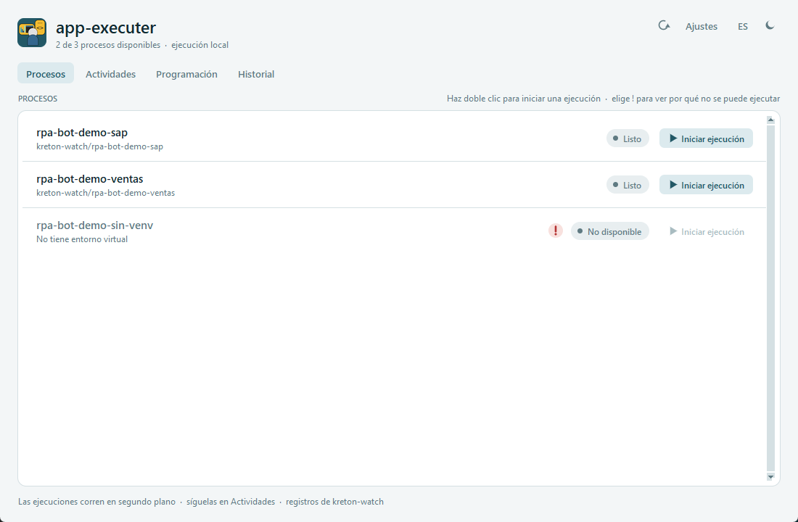
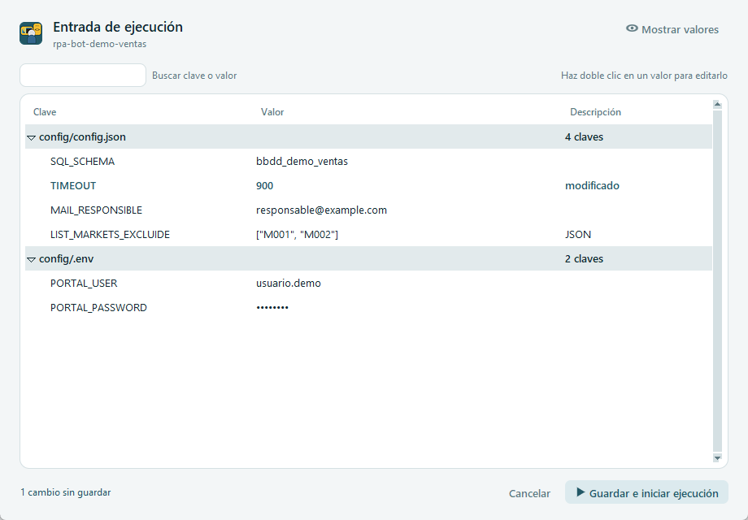
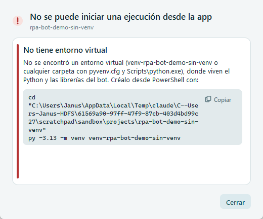

# Pestaña Procesos

[← Índice del manual](../README.md)

Lista todos los bots de `HDFS/projects/`, muestra si se pueden ejecutar y desde aquí se lanza una ejecución.

## Qué se ve

- **Encabezado de la lista:** *PROCESOS* a la izquierda; a la derecha la ayuda "Haz doble clic para iniciar una ejecución · elige ! para ver por qué no se puede ejecutar".
- **Una fila por carpeta de `projects/`**, primero las que se pueden ejecutar y después las que tienen `!` rojo, cada grupo en orden alfabético:

| Elemento | Qué muestra |
|---|---|
| Nombre | Nombre de la carpeta del bot. En gris si el bot no se puede ejecutar. |
| Línea inferior | `kreton-watch/<GROUP_LOG>`, la carpeta donde el bot escribe sus logs (se lee de `GROUP_LOG = '...'` o `log.set_group('...')` en su `main.py`). Si el bot no se puede ejecutar, aquí aparece el motivo principal. |
| Ícono `!` rojo / `i` ámbar | Hay un diagnóstico para ese bot: clic para ver la explicación (ver [Diagnóstico](#diagnóstico-por-qué-un-bot-no-se-puede-ejecutar)). |
| Estado | *Listo*, *No disponible*, *En ejecución*, *En cola* o el resultado de su última ejecución (*Correcto*, *Error (código de salida n)*…). Se actualiza cada segundo, también si el bot lo lanzó el driver. |
| Botón | **Iniciar ejecución**, o **Ver ejecución** si el bot está corriendo (lleva a Actividades). Deshabilitado si el bot no está disponible. |

- **Pie de página:** "Las ejecuciones corren en segundo plano · síguelas en Actividades · registros de kreton-watch".

La rueda del mouse desplaza la lista. Al pasar el mouse sobre una fila, esta se resalta.

### Qué carpetas aparecen

- Todas las de `PROJECTS_PATH` (por defecto `..`, es decir `HDFS/projects/`).
- No aparecen las de `EXCLUDED_PROJECTS` (por defecto `app-executer-main` y `testing`) ni las que empiezan con `.` o `_`.
- Para que aparezca un bot nuevo, presiona ↻ en la cabecera.

## Ejecutar un bot

1. Haz **doble clic** en la fila o presiona **Iniciar ejecución**.
2. Se abre la **Entrada de ejecución** con la configuración del bot (ver abajo). Revísala y, si hace falta, edítala.
3. Presiona **Guardar e iniciar ejecución**.
4. La app te lleva a la pestaña **Actividades** con la ejecución seleccionada.

Si el bot ya está corriendo, o ya hay `MAX_PARALLEL` bots corriendo, aparece el aviso **Ejecución en cola**: la ejecución arrancará sola apenas haya un cupo.

Si el bot **ya está en ejecución**, el botón dice **Ver ejecución** y lleva directo a su vista en Actividades (no se lanza otra).

## Entrada de ejecución (configuración antes de ejecutar)

Es una tabla con **todas las claves de los archivos que carga el `Pipeline` del bot**, para revisarlas o cambiarlas antes de ejecutar.

### De dónde salen los archivos

- La app lee `filename_args_json` y `filename_args_env` del `main.py` del bot. Normalmente son:
  - `config/config.json`
  - `common/.env` (compartido por todos los bots)
  - `config/.env`
- Si el `main.py` no los declara, usa `../config/config.json` y `../config/.env`.
- Cada archivo es una sección (fila gris) con su ruta, su número de claves y, si aplica, "compartido por todos los bots".
- Si un archivo declarado no existe, la sección sale en rojo con "no existe: el bot fallará al cargarlo".

### Columnas

| Columna | Contenido |
|---|---|
| **Clave** | Nombre de la variable. |
| **Valor** | Valor actual. Listas y objetos se muestran en JSON en una línea. |
| **Descripción** | *modificado* si lo cambiaste, *reemplazado por …* si otro archivo define la misma clave, *JSON* si es una lista u objeto. |

### Precedencia (igual que el `Pipeline`)

- Primero se cargan los `.json`, luego los `.env`, en el orden declarado. **Gana el último.**
- Una clave que otro archivo reemplaza aparece en **gris** con "reemplazado por *archivo*": cambiarla no tiene efecto.

### Valores secretos

- Las claves cuyo nombre contiene `PASS`, `PWD`, `SECRET`, `TOKEN`, `API_KEY`/`APIKEY` o `CREDENTIAL` se muestran como `••••••••`.
- **Mostrar valores** (arriba a la derecha) los muestra; **Ocultar valores** los vuelve a ocultar.
- Al editar un secreto oculto, el campo también enmascara lo que escribes.

### Buscar y editar

- **Buscar clave o valor:** filtra la tabla mientras escribes.
- **Editar un valor:** doble clic (o Enter) sobre la fila. **Enter** confirma y **Esc** cancela; al hacer clic afuera también se confirma.
  - En `config.json`, si el valor original era un número, `true`/`false` o `null`, el nuevo valor debe ser válido en JSON. Si no, aparece "Valor no válido" y sigues editando. Para escribir un texto, ponlo entre comillas dobles.
  - En los `.env` todo es texto.
- **Listas y objetos** (`["M001", "M002"]`, `{...}`): el doble clic abre un **editor JSON**. **Guardar** valida el formato; si hay un error, indica la línea y la columna.
- Lo que cambias queda en **naranja**. Abajo a la izquierda se cuenta: "1 cambio sin guardar".

### Guardar e iniciar ejecución

- **Sin cambios:** lanza el bot directamente.
- **Con cambios:** muestra qué claves se guardarán y en qué archivos. Si alguna está en `common/.env`, advierte que **el cambio afecta a TODOS los bots**. Al confirmar, guarda y lanza.

> ⚠️ **Los cambios quedan guardados en los archivos** (no son solo para esta ejecución): el `Pipeline` del bot lee la configuración de los archivos al arrancar.

Qué se reescribe al guardar:

- **Solo el valor editado.** El resto del archivo (orden, comentarios, comillas, formato de listas en una o varias líneas, BOM, saltos de línea) queda intacto.
- Si el archivo **cambió en disco** mientras lo editabas (otra persona, otro programa), no se guarda y se avisa. Cierra y vuelve a abrir.

**Cancelar** (o **Esc**) cierra sin guardar ni ejecutar. Si hay cambios, pide confirmación para descartarlos.

## Diagnóstico: por qué un bot no se puede ejecutar

Al hacer clic en el ícono `!` o `i` (o doble clic sobre un bot no disponible) se abre una ventana con cada problema, su explicación y, cuando aplica, un **comando listo para copiar** en PowerShell (botón **Copiar**).

**`!` rojo: el bot no se puede ejecutar desde la app**

| Problema | Qué significa | Cómo resolverlo |
|---|---|---|
| No tiene carpeta `src/` | El proyecto no sigue la estructura estándar. | Migrarlo al estándar KRETON. |
| La carpeta `src/` está vacía | Todavía no hay código (proyecto pendiente de migrar). | Migrarlo. |
| No tiene `src/main.py` | Tiene otros scripts, pero no un `main.py` con `Pipeline` (por ejemplo, un servidor web que se inicia con su `.bat`). | Ejecutarlo por fuera de la app. |
| No tiene entorno virtual | No hay `venv-<bot>` ni ninguna otra carpeta del bot que sea un venv (con `pyvenv.cfg` y `Scripts\python.exe`, por ejemplo `.venv`). | Copia el comando que trae la ventana: `cd`, `py -3.13 -m venv venv-<bot>` y `pip install -r requirements.txt`. Luego presiona ↻. |
| Falta `pi_kreton_rpa` en el entorno virtual | El bot usa la librería del equipo y no está instalada en su venv. | Instalar `requirements.txt` (comando incluido) o el `.whl` de `common/lib`. |

**`i` ámbar: el bot se puede ejecutar, pero con avisos**

| Aviso | Qué significa |
|---|---|
| No se verá la barra de progreso | El `main.py` usa `Pipeline(stream_output=False)`: la salida de tqdm de los jobs queda capturada. Se ven los logs y el tiempo, no el avance. |
| No se encontró `GROUP_LOG` | La app no sabe en qué carpeta de kreton-watch escribe el bot; busca en `kreton-watch/<nombre del bot>`. Si no coincide, no se verán los logs. |

**Entendido**, **Enter** o **Esc** cierran la ventana.

## Configuración relacionada (`config/config.json`)

| Clave | Uso en esta pestaña |
|---|---|
| `PROJECTS_PATH` | Carpeta donde se buscan los bots (relativa a la app). |
| `EXCLUDED_PROJECTS` | Carpetas que no se listan. |
| `WATCH_PATH` | Carpeta raíz de kreton-watch. |
| `MAX_PARALLEL` | Bots que pueden correr a la vez; el resto va a la cola. |

## Preguntas frecuentes

- **Creé el venv y el bot sigue "No disponible".** Presiona ↻ en la cabecera para volver a diagnosticar.
- **Cambié un valor y el bot no lo usó.** Revisa si estaba en gris ("reemplazado por …"): otro archivo define esa clave y gana.
- **¿Puedo cambiar un valor solo para esta ejecución?** No: el `Pipeline` lee los archivos al arrancar, así que el cambio queda guardado. Si quieres el valor anterior, vuelve a editarlo antes de la próxima ejecución.
