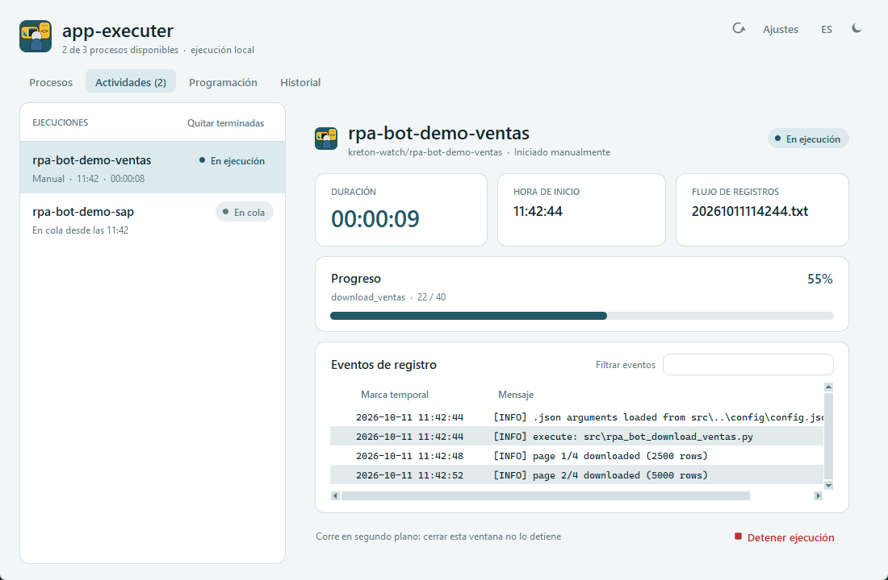
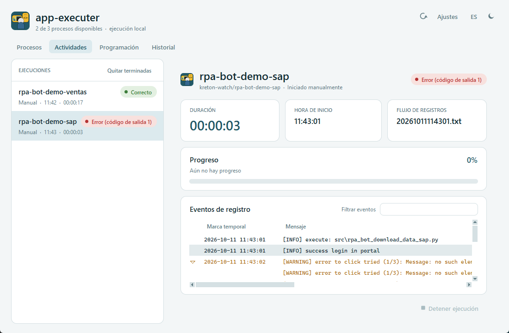
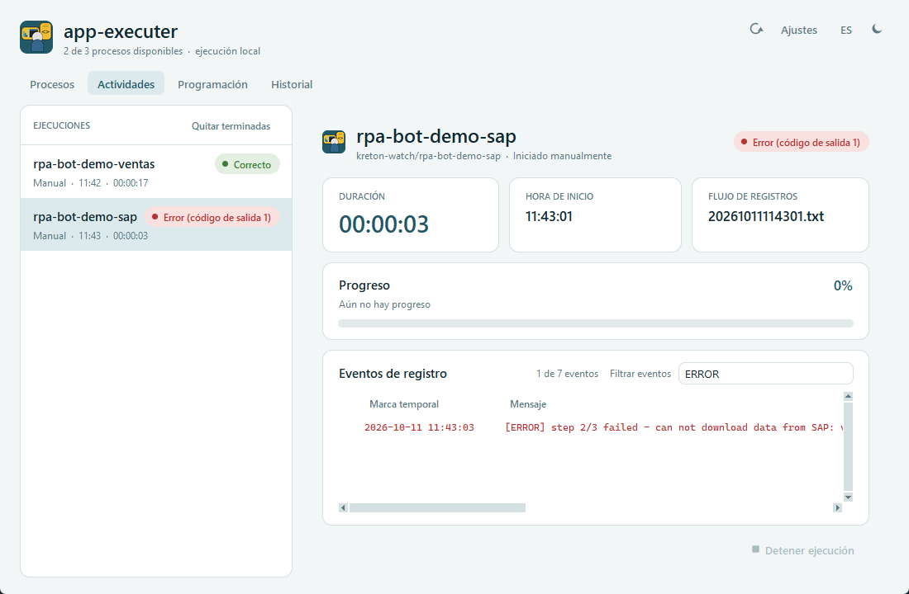
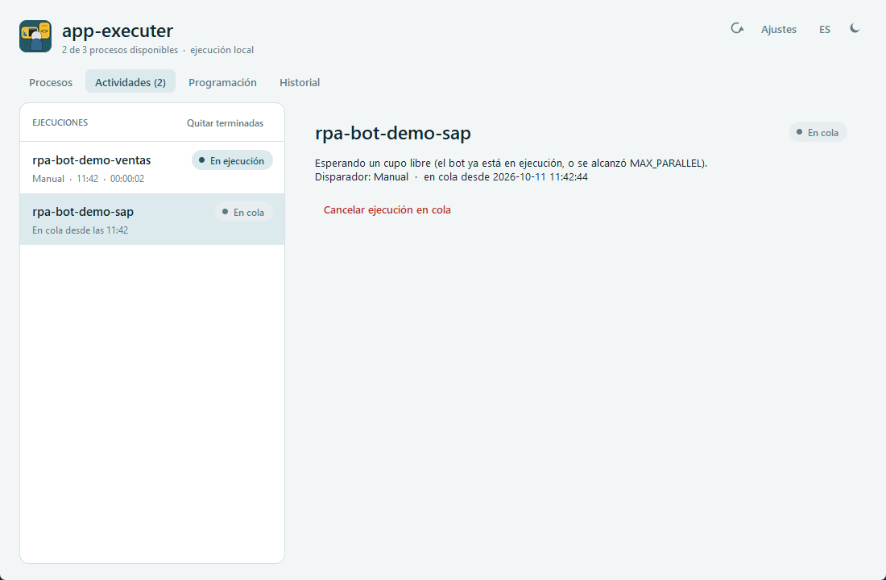

# Pestaña Actividades

[← Índice del manual](../README.md)

Muestra lo que está corriendo o esperando en cola y deja seguir cada ejecución en vivo: progreso, logs de kreton-watch, salida de consola, duración y estado. Todo en la misma ventana, sin ventanas aparte.

## Cuándo se usa

- Se abre sola al lanzar un bot desde **Procesos** (o desde **Iniciar ahora** en Programación).
- **Ver ejecución** en Procesos lleva aquí con la ejecución de ese bot seleccionada.
- También muestra lo que lanzó el driver (`CRON_DRIVER`), aunque la app estuviera cerrada cuando arrancó.
- La pestaña dice **Actividades (n)** cuando hay n ejecuciones en curso o en cola.

## Lista de ejecuciones (izquierda)

**EJECUCIONES** contiene tres tipos de elemento:

| Tipo | Qué muestra |
|---|---|
| En ejecución | Nombre del bot, estado *En ejecución*, disparador (*Manual* / *Horario*), hora de inicio y duración, que se actualiza cada segundo. |
| En cola | Nombre del bot, estado *En cola* y la hora desde la que espera. |
| Terminada | Las ejecuciones que terminaron **mientras la app estaba abierta**, con su resultado (*Correcto*, *Error (código de salida n)*, *Anulado*…) y su duración final. |

- **Clic** en un elemento para ver su detalle a la derecha.
- **Quitar terminadas** limpia de la lista las que ya terminaron (siguen en **Historial**).
- Si no hay nada, aparece "No hay ejecuciones en curso. Inicia una desde Procesos o espera un horario."

## Vista de la ejecución (derecha)

### Encabezado

- Nombre del bot.
- Debajo: `kreton-watch/<GROUP_LOG>` y cómo se inició (**Iniciado manualmente** o **Iniciado por horario (CRON_DRIVER)**).
- A la derecha: el estado actual.

### Tarjetas

| Tarjeta | Contenido |
|---|---|
| **DURACIÓN** | Tiempo transcurrido (`hh:mm:ss`). Se detiene al terminar. |
| **HORA DE INICIO** | Hora en que el runner lanzó el bot. |
| **FLUJO DE REGISTROS** | Nombre del archivo de log del bot en kreton-watch (`<run_id>.txt`). Muestra *Esperando...* hasta que el bot crea su log y *-* si nunca lo creó. |

### Progreso

- Lee la **barra tqdm** que imprime cada job del bot: muestra la descripción (`download_ventas`), el avance `n / total`, el porcentaje y una barra.
- Si el bot usa `Pipeline(stream_output=False)` aparece "Este bot no informa el progreso": su salida de tqdm queda capturada por el Pipeline.
- Si todavía no ha impreso ninguna barra: "Aún no hay progreso".

### Eventos de registro

Tabla al estilo de CloudWatch con las columnas **Marca temporal | Mensaje**:

- Cada línea del log de kreton-watch es un evento, con el nivel al inicio del mensaje: `[INFO]`, `[WARNING]` (ámbar), `[ERROR]` (rojo).
- La salida de consola del bot que no es una barra tqdm (por ejemplo, un *traceback* de Python) aparece en **gris**, sin marca temporal. Un traceback completo se agrupa en un solo evento.
- **Mensajes largos sin ajuste de línea:** se recorren con la barra horizontal o con **Shift + rueda**.

**Errores de varias líneas.** `pi_kreton_rpa` convierte los saltos de línea de un error en espacios, así que un error de Selenium o un traceback llega en una sola línea gigante. La app reconstruye las líneas y muestra el evento así:

- **Colapsado:** la primera línea y "(+N líneas, expande con ▶)". En un traceback se muestra la línea de la excepción, por ejemplo `TimeoutError: ...`.
- **Expandido (▶ o doble clic):** una línea por fila (`Session info`, `Stacktrace`, cada frame `chromedriver!...`).

**Filtrar eventos.** La caja **Filtrar eventos** funciona así:

- Si escribes un nivel (`ERROR`, `WARNING` o `WARN`, `INFO`), solo se ven los eventos de ese nivel.
- Cualquier otro texto se busca en la marca temporal y en el mensaje, sin distinguir mayúsculas (por ejemplo `HA_1`, `variant`, `12:31`).
- El contador muestra "*n* de *m* eventos". **Esc** limpia el filtro.
- Los eventos que llegan con el filtro activo solo aparecen si coinciden.

**Copiar.** Desde el **clic derecho** sobre una o varias filas seleccionadas:

| Opción | Copia |
|---|---|
| **Copiar mensaje** | Solo el mensaje. Un evento de varias líneas se copia con sus saltos de línea. |
| **Copiar evento (marca temporal y mensaje)** | Marca temporal + tabulación + mensaje (también **Ctrl + C**). |
| **Seleccionar todo** | Todas las filas (también **Ctrl + A**). |

### Pie

- "Corre en segundo plano: cerrar esta ventana no lo detiene". Cerrar la app tampoco detiene el bot.
- **Detener ejecución:** pide confirmación y termina el bot **con todos sus subprocesos** (jobs, Chrome, etc.). El estado pasa a *Deteniendo* y luego a **Anulado**. Si había otro bot en cola, arranca en ese momento.

## Ejecución en cola

Al seleccionar un elemento **En cola** se ve:

- por qué espera (el bot ya está en ejecución, o se alcanzó `MAX_PARALLEL`);
- su disparador y desde qué hora está en cola;
- **Cancelar ejecución en cola**: la saca de la cola. Queda en el historial como *Cancelada*.

Cada bot puede tener como máximo **una** ejecución en cola. Si se pide otra mientras ya hay una esperando, se ignora.

## Configuración relacionada (`config/config.json`)

| Clave | Uso |
|---|---|
| `MAX_PARALLEL` | Máximo de bots corriendo a la vez (2). El resto espera en cola. |
| `POLL_MS` | Cada cuántos milisegundos la vista lee la salida y el log (200). |
| `MAX_LOG_LINES` | Máximo de eventos que guarda la tabla por ejecución (5000); se descartan los más antiguos. |
| `WATCH_PATH` | Carpeta de kreton-watch donde se buscan los logs. |

## De dónde sale cada dato

| Dato | Fuente |
|---|---|
| Progreso y consola | `%LOCALAPPDATA%\app-executer-main\scheduler\runs\<bot>\<run_id>.out` (stdout y stderr del bot, que guarda el runner) |
| Eventos de registro | `kreton-watch/<GROUP_LOG>/<run_id>.txt` (el log del `main.py` del bot) |
| Estado en vivo | `scheduler\locks\<bot>.json` (existe mientras el bot corre) |
| Resultado final | `scheduler\history.jsonl` |

## Preguntas frecuentes

- **Cerré la app con un bot corriendo, ¿se detuvo?** No. Al volver a abrirla, aparece aquí y la vista se pone al día leyendo los archivos.
- **La barra de progreso no se mueve.** El bot no imprime tqdm, o usa `stream_output=False`. Los logs y la duración siguen funcionando.
- ***Flujo de registros* se queda en *Esperando...*.** El bot todavía no escribió su log, o su `GROUP_LOG` no coincide con la carpeta que espera la app (ver el aviso `i` en Procesos).
- **Aparece *Interrumpido*.** El runner desapareció sin registrar el final, por ejemplo porque se apagó o reinició el PC durante la ejecución.
