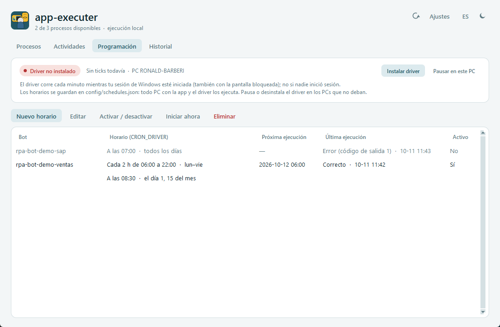
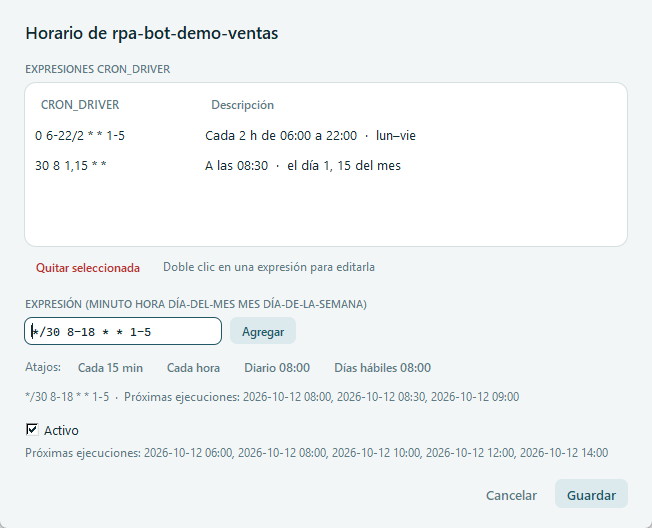

# Pestaña Programación

[← Índice del manual](../README.md)

Programa la ejecución automática de los bots con expresiones cron (`CRON_DRIVER`), muestra si el *driver* está funcionando en este PC y permite pausarlo.



## Cómo funciona la programación

1. Los horarios se guardan en **`config/schedules.json`**: una lista de expresiones `CRON_DRIVER` por bot y si está activo.
2. El **driver** es una tarea del Programador de tareas de Windows (`app-executer-main driver`) que cada minuto ejecuta `main.py --tick`.
3. En cada *tick* la app revisa qué horarios vencieron desde el tick anterior y lanza esos bots en segundo plano, igual que una ejecución manual: aparecen en **Actividades** y en **Historial** con disparador *Horario*.

El driver lo instala `setup-app-executer-main.bat`, o el botón **Instalar driver** de esta pestaña.

### Requisito: sesión de Windows iniciada

- El driver corre **mientras tu sesión de Windows esté iniciada**, también con la **pantalla bloqueada (Win + L)** o el PC desatendido.
- **No corre si nadie inició sesión** (por ejemplo, después de reiniciar).
- Motivo: `pi_kreton_rpa` envía los correos con Outlook y lee los archivos NASCA con Excel, y los dos necesitan tu escritorio.
- Recomendación: **bloquea el PC, no cierres la sesión**. Después de un reinicio, inicia sesión para que la programación siga.

## Tarjeta del driver (arriba)

| Elemento | Significado |
|---|---|
| **Driver activo** (verde) | La tarea existe, está habilitada y ejecuta esta copia de la app. |
| **Driver no instalado** (rojo) | No existe la tarea: los horarios **no se ejecutan** en este PC. Aparece **Instalar driver**. |
| **Driver deshabilitado en el Programador de tareas** (ámbar) | Alguien deshabilitó la tarea en Windows. Habilítala desde el Programador de tareas. |
| **El driver ejecuta otra copia de la app** (ámbar) | La tarea apunta a otra carpeta (la app se movió o se copió). Usa **Instalar driver** para apuntarla a esta. |
| **En pausa en este PC** (ámbar) | La programación está pausada aquí (ver abajo). |
| Último tick · PC | Hora del último tick y nombre del equipo. Si no avanza cada minuto, el driver no está corriendo. |
| **Pausar en este PC / Reanudar en este PC** | Pausa o reanuda la programación **solo en este PC**: los ticks siguen, pero no lanzan nada. No modifica `schedules.json`. |
| **Instalar driver** | Ejecuta el setup con `-NoShortcut` (registra la tarea, sin tocar el acceso directo) y muestra el resultado. |

> ⚠️ **Varios PCs:** `schedules.json` viaja con la app. **Todo PC que tenga la app y el driver ejecuta esos horarios**, así que dos PCs con el driver duplicarían las ejecuciones (dobles correos, dobles cargas SQL). En los PCs que no deben ejecutar, usa **Pausar en este PC**, instala con `setup-app-executer-main.bat -NoScheduler` o desinstala con `-RemoveScheduler`.

## Tabla de horarios

| Columna | Contenido |
|---|---|
| **Bot** | Nombre del bot. |
| **Horario (CRON_DRIVER)** | Cada expresión en texto legible, por ejemplo "Cada 2 h de 06:00 a 22:00 · lun–vie". Si un bot tiene varias, cada expresión adicional va en una sub-fila. Una expresión inválida se muestra con `(!)` en rojo y el driver la ignora. |
| **Próxima ejecución** | Fecha y hora más cercana entre todas sus expresiones. Muestra *—* si el horario está desactivado o el PC está en pausa. |
| **Última ejecución** | Resultado y fecha de la última ejecución del bot (manual o programada). |
| **Activo** | *Sí* / *No*. Los horarios desactivados se ven en gris. |

La tabla se recalcula cada 10 s y después de cada cambio.

## Acciones

Para todas, excepto **Nuevo horario**, primero selecciona una fila.

| Botón | Qué hace |
|---|---|
| **Nuevo horario** | Abre el editor para un bot que todavía no tiene horario. |
| **Editar** (o doble clic en la fila) | Abre el editor con las expresiones del bot. |
| **Activar / desactivar** | Cambia *Activo* sin borrar las expresiones. |
| **Iniciar ahora** | Ejecuta el bot ya, como una ejecución manual: abre la Entrada de ejecución. |
| **Eliminar** | Pide confirmación y quita el horario del bot (deja de ejecutarse automáticamente). |

Todos los cambios se guardan de inmediato en `config/schedules.json`. Si el archivo cambió en disco mientras tanto (otra persona u otro PC), no se guarda y se avisa.

## Editor de horario



1. **Bot** (solo en un horario nuevo): lista de los bots que se pueden ejecutar y todavía no tienen horario.
2. **EXPRESIONES CRON_DRIVER:** las expresiones actuales con su descripción.
   - **Doble clic** en una la pasa al campo de edición para modificarla.
   - **Quitar seleccionada** la elimina.
3. **EXPRESIÓN:** escribe una expresión y presiona **Agregar** (o Enter).
   - Mientras escribes, la línea de abajo la valida: si es válida, muestra su descripción y las próximas 3 ejecuciones; si no, el error, por ejemplo `"99" no es válido en el campo 1 (permitido 0-59)`.
   - Para combinaciones poco comunes (como `*/30 8-18 * * 1-5`) no hay descripción en texto: se muestra la expresión tal cual, junto con sus próximas ejecuciones.
4. **Atajos:** *Cada 15 min* (`*/15 * * * *`), *Cada hora* (`0 * * * *`), *Diario 08:00* (`0 8 * * *`), *Días hábiles 08:00* (`0 8 * * 1-5`). Escriben la expresión en el campo; luego presiona **Agregar**.
5. **Activo:** si se desmarca, el horario se guarda pero no se ejecuta.
6. **Próximas ejecuciones:** las 5 siguientes, combinando todas las expresiones del bot.
7. **Guardar:** si quedó una expresión válida escrita sin agregar, la agrega. Exige un bot y al menos una expresión. **Cancelar** o **Esc** cierran sin guardar.

## Sintaxis de las expresiones (cron de 5 campos)

```
┌──────── minuto        (0-59)
│ ┌────── hora          (0-23)
│ │ ┌──── día del mes   (1-31)
│ │ │ ┌── mes           (1-12 o JAN-DEC)
│ │ │ │ ┌ día de semana (0-7 o SUN-SAT; 0 y 7 = domingo)
│ │ │ │ │
* * * * *
```

| Símbolo | Significado | Ejemplo |
|---|---|---|
| `*` | Todos los valores | `* * * * *` = cada minuto |
| `a-b` | Rango | `1-5` = lunes a viernes |
| `a,b,c` | Lista | `10,15,18,22` |
| `*/n` o `a-b/n` | Cada n | `*/15` = cada 15 min; `6-22/2` = cada 2 h de 6 a 22 |
| Nombres | Meses y días en inglés, sin importar mayúsculas | `MON-FRI`, `JAN,JUL` |
| Atajos | `@hourly`, `@daily`, `@midnight`, `@weekly`, `@monthly`, `@yearly` / `@annually` | `@daily` = `0 0 * * *` |

Si se restringen **a la vez** el día del mes y el día de la semana, basta con que se cumpla **uno** de los dos (como en el cron clásico). Por ejemplo, `0 0 1 * MON` corre el día 1 **y** todos los lunes. Si uno de los dos empieza con `*` (incluido `*/2`), deben cumplirse ambos.

**Ejemplos del equipo**

| Necesidad | Expresión |
|---|---|
| Lunes a viernes, cada 2 h de 06:00 a 22:00 (D2C Dashboard) | `0 6-22/2 * * 1-5` |
| 10:00, 15:00, 18:00 y 22:00 todos los días | `0 10,15,18,22 * * *` |
| Días hábiles a las 07:30 | `30 7 * * 1-5` |
| Los lunes a las 06:00 | `0 6 * * MON` |
| Días 1 y 15 del mes a las 08:30 | `30 8 1,15 * *` |
| Cada 30 min de 08:00 a 18:30, días hábiles | `*/30 8-18 * * 1-5` |

## Reglas de ejecución

- **Hora local del PC.** Un tick que llega con unos segundos o minutos de retraso igual ejecuta.
- **Ejecuciones perdidas.** Si una ejecución tiene más de `MISSED_AFTER_MINUTES` (5) minutos de retraso (PC apagado, suspendido o sin sesión), **no se recupera**. Queda en el historial como **Perdida (n)**, un aviso por expresión.
- **Solapamiento.** Si el bot sigue corriendo cuando llega su hora, o ya hay `MAX_PARALLEL` bots corriendo, la ejecución va **a la cola** (máximo una por bot) y arranca sola cuando hay cupo.
- **Varias expresiones que vencen en el mismo minuto** generan **una sola** ejecución.

## Formato de `config/schedules.json`

Se puede editar a mano. La pestaña lo vuelve a leer en el siguiente refresco.

```json
{
    "rpa-bot-d2c-dashboard": {"CRON_DRIVER": ["0 6-22/2 * * 1-5"], "ENABLED": true},
    "rpa-bot-alkosto-shipping-orders": {"CRON_DRIVER": ["0 10,15,18,22 * * *"], "ENABLED": false}
}
```

## Migrar un bot que hoy está en el Programador de tareas de Windows

1. Crea su horario aquí, con la misma frecuencia.
2. **Desactiva la tarea antigua** en el Programador de tareas del PC donde esté; si no, el bot correrá dos veces.
3. Revisa en **Historial** la primera ejecución con disparador *Horario*.

## Configuración relacionada (`config/config.json`)

| Clave | Uso |
|---|---|
| `SCHEDULES_FILE` | Archivo de horarios (`config/schedules.json`). |
| `MAX_PARALLEL` | Bots corriendo a la vez (2); el resto va a la cola. |
| `MISSED_AFTER_MINUTES` | Minutos de retraso tras los cuales una ejecución cuenta como perdida (5). |
| `HISTORY_DAYS` | Días que se conserva el historial (30). |

Opciones del setup:

| Opción | Efecto |
|---|---|
| (sin opciones) | Instala o actualiza el driver. |
| `-NoScheduler` | No instala el driver (este PC no ejecuta horarios). |
| `-RemoveScheduler` | Solo desinstala el driver. |

## Solución de problemas

| Síntoma | Causa probable | Qué hacer |
|---|---|---|
| *Driver no instalado* | Nunca se corrió el setup en este PC, o se desinstaló. | **Instalar driver**. |
| *El driver ejecuta otra copia de la app* | Moviste o copiaste la carpeta de la app. | **Instalar driver** (o vuelve a correr el setup). |
| El último tick no avanza | Nadie inició sesión, la tarea está deshabilitada o falló. | Inicia sesión y revisa la tarea en el Programador de tareas y `%LOCALAPPDATA%\app-executer-main\scheduler\driver.log`. |
| Aparecen *Perdida (n)* | El PC estuvo apagado, suspendido o sin sesión a esa hora. | Es lo esperado: no se recuperan. |
| Un bot corrió dos veces a la misma hora | Hay dos PCs con el driver, o sigue activa su tarea antigua de Windows. | Pausa o desinstala el driver en el otro PC, o desactiva la tarea antigua. |
| La expresión sale con `(!)` en rojo | La expresión es inválida. | **Editar** y corregir; el editor dice qué campo está mal. |
