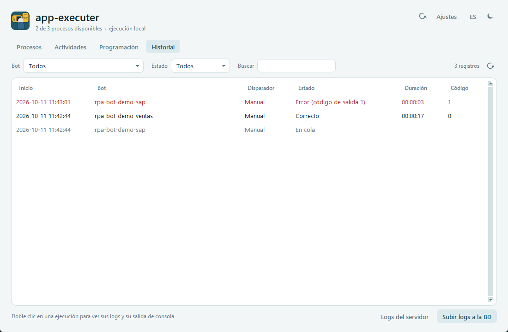
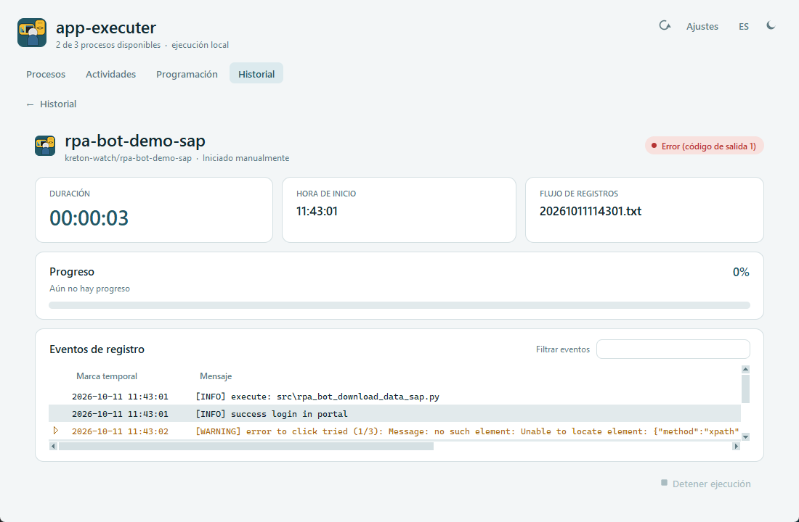
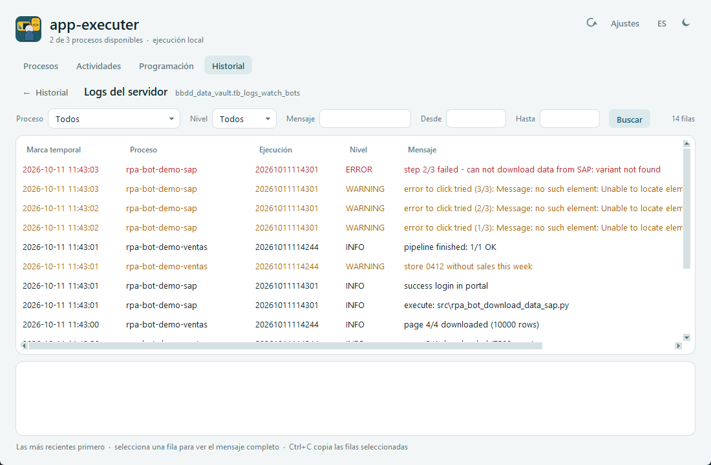

# Pestaña Historial

[← Índice del manual](../README.md)

Lista todas las ejecuciones de este PC (manuales y programadas) y los avisos del scheduler, con filtros. Cada ejecución se puede abrir para ver sus logs y su salida de consola.

## Filtros (arriba)

| Filtro | Uso |
|---|---|
| **Bot** | *Todos* o un bot concreto (lista de los bots que aparecen en el historial). |
| **Estado** | *Todos*, *En ejecución*, *Correcto*, *Error* (incluye *Error al iniciar* e *Interrumpido*), *Anulado*, *Perdida* o *En cola* (incluye *Cancelada*). |
| **Buscar** | Texto libre sobre todas las columnas, sin distinguir mayúsculas (por ejemplo `2026-10-09`, `Horario`, `código de salida 1`). |
| *n registros* | Cuántas filas cumplen los filtros. |
| ↻ | Vuelve a leer el historial. Además se refresca solo cuando cambia, y cada segundo si hay ejecuciones en curso. |

Los filtros se combinan entre sí.

## Columnas

| Columna | Contenido |
|---|---|
| **Inicio** | Fecha y hora de inicio. En los avisos, la hora en que se registró el aviso. |
| **Bot** | Nombre del bot. |
| **Disparador** | *Manual* (desde la app) o *Horario* (`CRON_DRIVER`). |
| **Estado** | Resultado (ver [estados](../README.md#estados)). |
| **Duración** | `hh:mm:ss`. Si está en ejecución, sigue contando. |
| **Código** | Código de salida del `main.py` del bot (0 = correcto). |

Las filas en rojo terminaron con error. Las filas grises son **avisos**, no ejecuciones:

| Aviso | Significado |
|---|---|
| **En cola** | La ejecución tuvo que esperar (el bot ya corría o se alcanzó `MAX_PARALLEL`). Cuando arrancó, aparece como una ejecución aparte. |
| **Cancelada** | Alguien sacó esa ejecución de la cola en Actividades. |
| **Perdida (n)** | n ejecuciones programadas no se hicieron porque el PC estaba apagado, suspendido o sin sesión. |

## Ver una ejecución

**Doble clic** (o Enter) sobre una ejecución la abre con la misma vista de [Actividades](../02-actividades/README.md#vista-de-la-ejecución-derecha):

- duración, hora de inicio y archivo de log;
- última barra de progreso informada;
- eventos de registro con filtro, eventos de varias líneas expandibles y copiar;
- salida de consola, por ejemplo el traceback, al final.

**← Historial** vuelve a la lista. Los avisos (filas grises) no se abren.

Si la ejecución sigue en curso, la vista se actualiza en vivo igual que en Actividades, con **Detener ejecución** disponible.

## Subir logs a la BD

El botón **Subir logs a la BD** (abajo a la derecha) sube a MySQL todos los logs de la [carpeta de logs](../05-ajustes/README.md#logs) y después **los borra de la carpeta**. La base de datos y las credenciales se configuran en [Ajustes](../05-ajustes/README.md).

1. La app cuenta los logs que se pueden subir y pide confirmación, por ejemplo: "Se subirán 42 archivos de log de C:\…\kreton-watch a bbdd_data_vault.tb_logs_watch_bots y después se borrarán de la carpeta".
2. Mientras sube, el botón muestra el avance (*Subiendo 12/42...*).
3. Al terminar muestra el resumen: "N archivos subidos y borrados (R filas), M omitidos (bots en ejecución)".

Reglas:

- **Los logs de bots en ejecución no se tocan.** Se omiten los de las ejecuciones en curso de la app y cualquier log que otro proceso tenga abierto, por ejemplo un bot lanzado desde su `.bat`. Se suben en una próxima subida.
- **Cada archivo se sube completo o no se sube.** Si un archivo falla, se deshace lo que alcanzó a subir y queda en la carpeta. El resumen muestra el error.
- **No se duplica nada.** Antes de insertar un archivo se borran de la tabla las filas de la misma ejecución (`process_name` + `id_process`). Así, volver a subir un log no repite filas.
- Las carpetas de `GROUP_LOG` que quedan vacías se borran.
- Cada línea del log queda como una fila: `process_name` (GROUP_LOG), `id_process` (run_id), `timestamp_log`, `type_log` (INFO, WARNING, ERROR...), `message` y `update_at` (fecha y hora de la subida).

Después de subir un log, la vista de esa ejecución en el historial ya no muestra sus eventos de registro, porque el archivo se borró. La salida de consola sí se conserva. Los eventos se consultan en **Logs del servidor**.

## Logs del servidor

**Logs del servidor** muestra los logs que ya están en la base de datos. **← Historial** vuelve a la lista.

| Filtro | Uso |
|---|---|
| **Proceso** | *Todos* o un `GROUP_LOG` (la lista se llena con los procesos que hay en la tabla). |
| **Nivel** | *Todos*, `INFO`, `WARNING`, `ERROR`, `DEBUG` o `CRITICAL`. |
| **Mensaje** | Texto que contiene el mensaje. |
| **Desde** / **Hasta** | Fechas en formato `AAAA-MM-DD` (ambas incluidas). |
| **Buscar** | Consulta el servidor (también con Enter en los campos de texto). |

- Muestra las filas más recientes primero, hasta `LOG_DB.QUERY_LIMIT` (1000). Si hay más, el contador lo indica; ajusta los filtros para ver las anteriores.
- Las filas `WARNING` salen en ámbar y las `ERROR`/`CRITICAL` en rojo.
- Al seleccionar una fila, abajo se muestra el mensaje completo, incluidos los tracebacks de varias líneas.
- **Ctrl+C** copia las filas seleccionadas, separadas por tabulaciones.

## Qué se guarda y por cuánto tiempo

- El historial está en `%LOCALAPPDATA%\app-executer-main\scheduler\history.jsonl` y la salida de consola de cada ejecución en `scheduler\runs\<bot>\<run_id>.out`. **Es de cada PC**: no se comparte con otros equipos.
- Los eventos de registro se leen del log del bot en la [carpeta de logs](../05-ajustes/README.md#logs). Si alguien borró ese archivo (o ya se subió a la base de datos), la vista muestra *-* en *Flujo de registros* y solo la salida de consola.
- Se conservan `HISTORY_DAYS` días (30): el historial y los `.out` más antiguos se borran solos una vez al día. Una ejecución se conserva entera mientras haya **terminado** dentro de ese plazo.

## Configuración relacionada (`config/config.json`)

| Clave | Uso |
|---|---|
| `HISTORY_DAYS` | Días de historial y de salidas de consola que se conservan (30). |
| `WATCH_PATH` | Carpeta de logs por defecto. Se cambia por PC en [Ajustes](../05-ajustes/README.md). |
| `LOG_DB` | Base de datos de logs: Python con pymysql, `.env`, base, tabla y `QUERY_LIMIT`. Ver [Ajustes](../05-ajustes/README.md#configuración-relacionada-configconfigjson). |

## Preguntas frecuentes

- **No veo las ejecuciones de otro PC.** El historial es local de cada PC.
- **Una ejecución no tiene log.** El bot terminó antes de escribirlo (por ejemplo, falló al importar), o su `GROUP_LOG` no coincide con la carpeta que espera la app. Revisa la salida de consola en la misma vista.
- **¿Cómo veo solo los fallos de un bot?** **Bot** = el bot y **Estado** = *Error*.
- **"No se encontró un Python con pymysql".** Ningún venv de `projects/` tiene `pymysql`. Instálalo en uno (`<venv>\Scripts\python.exe -m pip install pymysql`) o elige otro Python en [Ajustes](../05-ajustes/README.md).
- **Quedaron logs sin subir.** Eran de bots en ejecución o tuvieron un error, que aparece en el resumen. Vuelve a presionar **Subir logs a la BD** cuando terminen.
