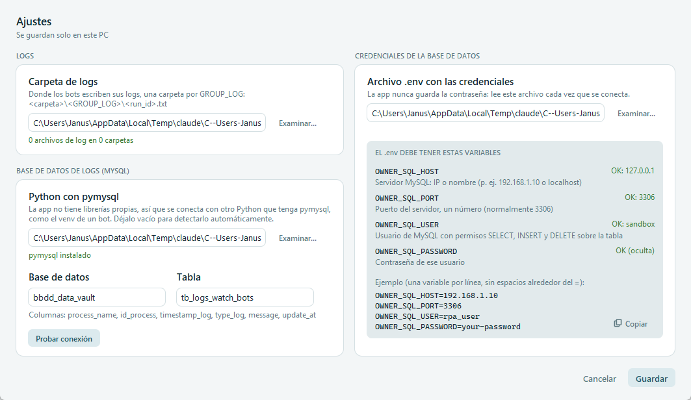

# Ajustes

[← Índice del manual](../README.md)

El botón **Ajustes** de la cabecera abre la configuración de **este PC**: la carpeta donde los bots escriben sus logs y la base de datos a la que se suben. Se guarda en `%LOCALAPPDATA%\app-executer-main\settings.json` y no cambia `config/config.json`. Cada PC puede tener sus propias rutas.



Cada valor se revisa mientras lo escribes: el texto de abajo sale en verde si está bien y en rojo si falta algo.

## Logs

| Campo | Uso |
|---|---|
| **Carpeta de logs** | Donde los bots escriben sus logs, una carpeta por `GROUP_LOG`: `<carpeta>\<GROUP_LOG>\<run_id>.txt`. Por defecto `HDFS\kreton-watch`. Debajo se ve cuántos archivos de log hay. |

La usan las vistas de ejecución (eventos de registro en vivo), el *runner* y el driver, y la subida a la base de datos. Al guardar, la app vuelve a leer los procesos.

## Base de datos de logs (MySQL)

| Campo | Uso |
|---|---|
| **Python con pymysql** | La app no tiene librerías propias, así que se conecta a MySQL con otro Python que tenga `pymysql`, por ejemplo el venv de un bot. **Vacío** = la app usa el primer venv de `projects/` que tenga `pymysql` (debajo se muestra cuál). Si el Python elegido no lo tiene, se muestra el comando para instalarlo. |
| **Base de datos** y **Tabla** | Destino de los logs. Por defecto `bbdd_data_vault` y `tb_logs_watch_bots`. La tabla debe tener las columnas `process_name, id_process, timestamp_log, type_log, message, update_at`. |
| **Probar conexión** | Se conecta con los valores de la ventana, aunque todavía no los hayas guardado, y revisa que la tabla tenga esas columnas. Si funciona, muestra cuántas filas tiene la tabla. Si no, muestra el error: falta una variable, el puerto no es un número, la contraseña es incorrecta, no hay acceso al servidor, etc. |

## Credenciales de la base de datos

| Campo | Uso |
|---|---|
| **Archivo .env con las credenciales** | Por defecto `HDFS\common\.env`. **La app nunca guarda la contraseña**: lee este archivo cada vez que se conecta. |

El recuadro **El .env debe tener estas variables** explica cada una y dice si el archivo la tiene:

| Variable | Qué debe llevar |
|---|---|
| `OWNER_SQL_HOST` | Servidor MySQL: IP o nombre (por ejemplo `192.168.1.10` o `localhost`). |
| `OWNER_SQL_PORT` | Puerto del servidor, un número (normalmente `3306`). |
| `OWNER_SQL_USER` | Usuario de MySQL con permisos `SELECT`, `INSERT` y `DELETE` sobre la tabla. |
| `OWNER_SQL_PASSWORD` | Contraseña de ese usuario. La ventana solo dice *OK (oculta)*, nunca la muestra. |

Ejemplo (una variable por línea, sin espacios alrededor del `=`). El botón **Copiar** lo copia:

```env
OWNER_SQL_HOST=192.168.1.10
OWNER_SQL_PORT=3306
OWNER_SQL_USER=rpa_user
OWNER_SQL_PASSWORD=your-password
```

Los nombres de las variables están en `config/config.json` (`LOG_DB.ENV_KEYS`), y son los mismos de `common\.env`.

## Guardar

**Guardar** aplica los cambios al instante. La carpeta de logs debe existir. **Cancelar** (o Esc) cierra sin guardar.

Para subir los logs y consultarlos, ver [Historial → Subir logs a la BD](../04-historial/README.md#subir-logs-a-la-bd) y [Logs del servidor](../04-historial/README.md#logs-del-servidor).

## Configuración relacionada (`config/config.json`)

Son los valores por defecto. Lo que se guarda en Ajustes los reemplaza en este PC.

| Clave | Uso |
|---|---|
| `WATCH_PATH` | Carpeta de logs por defecto (`../../kreton-watch`, relativa a la app). |
| `LOG_DB.PYTHON` | Python con `pymysql` (vacío = detectar). |
| `LOG_DB.ENV_FILE` | `.env` con las credenciales (`../../common/.env`). |
| `LOG_DB.ENV_KEYS` | Nombres de las variables del `.env` para el servidor, el puerto, el usuario y la contraseña. No se editan desde la ventana. |
| `LOG_DB.DATABASE`, `LOG_DB.TABLE` | Base de datos y tabla de destino. |
| `LOG_DB.QUERY_LIMIT` | Máximo de filas que muestra **Logs del servidor** (1000). |
