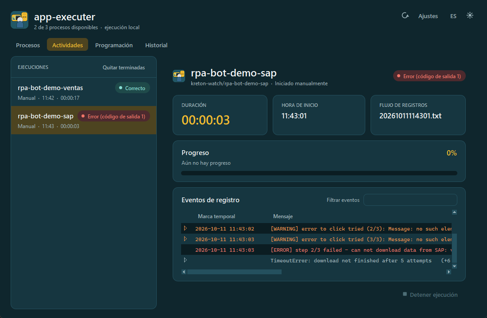

# Manual de uso: app-executer-main

App de escritorio para ejecutar los bots RPA de `HDFS/projects/`, seguirlos en vivo, programarlos con `CRON_DRIVER` y revisar su historial.

> Instalación, configuración técnica y arquitectura: [README del proyecto](../../README.md).
> Las capturas de este manual se tomaron con bots de demostración (`rpa-bot-demo-*`); no contienen datos reales.

## Manual por pestaña

| Pestaña | Para qué sirve | Manual |
|---|---|---|
| **Procesos** | Ver todos los bots, saber cuáles se pueden ejecutar (y por qué no) y lanzar una ejecución revisando antes su configuración | [01-procesos](01-procesos/README.md) |
| **Actividades** | Seguir en vivo lo que está corriendo o en cola: progreso, logs, consola, duración; detener o cancelar | [02-actividades](02-actividades/README.md) |
| **Programación** | Programar bots con expresiones cron, ver el estado del driver y pausar la programación en un PC | [03-programacion](03-programacion/README.md) |
| **Historial** | Consultar todas las ejecuciones pasadas (manuales y programadas) y abrir cada una con sus logs; subir los logs a la base de datos y consultarlos | [04-historial](04-historial/README.md) |
| **Ajustes** (botón de la cabecera) | Carpeta de logs y base de datos de logs (Python con pymysql, `.env` con las credenciales, base y tabla) de este PC | [05-ajustes](05-ajustes/README.md) |

## Cabecera (común a todas las pestañas)

| Elemento | Función |
|---|---|
| Logo y `app-executer-main` | Nombre de la app. Debajo: cuántos bots se pueden ejecutar (por ejemplo, "16 de 20 procesos disponibles"). |
| ↻ | Vuelve a leer la carpeta `projects/` y vuelve a diagnosticar cada bot (útil después de crear un venv o agregar un bot). |
| **Ajustes** | Abre la configuración de este PC: carpeta de logs y base de datos de logs (ver [05-ajustes](05-ajustes/README.md)). |
| **EN / ES** | Cambia el idioma de toda la app al instante. La elección se recuerda por usuario. Los mensajes que escriben los bots en su log no se traducen. |
| ☾ / ☀ | Cambia entre el modo claro y el oscuro (paleta de KretoN). |
| Pestañas | **Actividades** muestra entre paréntesis cuántas ejecuciones hay en curso o en cola, por ejemplo "Actividades (2)". |

## Conceptos que se usan en todas las pestañas

### Las ejecuciones corren en segundo plano

Toda ejecución (manual o programada) la hace un proceso independiente, el *runner* (`main.py --run <bot>`), que:

1. ejecuta `<venv>\Scripts\python.exe src\main.py` del bot (`venv-<bot>` o, si no existe, cualquier venv del bot, como `.venv`) (sin pasar por su `.bat`);
2. guarda la salida de consola del bot en un archivo;
3. detecta el log del bot en `<carpeta de logs>/<GROUP_LOG>/` (por defecto `kreton-watch`, se cambia en [Ajustes](05-ajustes/README.md));
4. registra el resultado en el historial.

Por eso **cerrar la app no detiene los bots**. Al volver a abrirla, los que siguen corriendo aparecen en **Actividades**.

### Un bot a la vez, y un máximo de bots en paralelo

- Un mismo bot no se ejecuta dos veces al mismo tiempo.
- Como máximo corren `MAX_PARALLEL` bots a la vez (2 por defecto, en `config/config.json`).
- Lo que no tiene cupo queda **en cola**, como máximo una vez por bot, y arranca solo apenas se libera un cupo.

### Estados

| Estado | Significado |
|---|---|
| **Listo** | El bot se puede ejecutar y no está corriendo. |
| **No disponible** | Al bot le falta algo para ejecutarse desde la app (ver [Procesos → Diagnóstico](01-procesos/README.md#diagnóstico-por-qué-un-bot-no-se-puede-ejecutar)). |
| **En ejecución** | Está corriendo ahora. |
| **En cola** | Espera un cupo (el bot ya corre, o se alcanzó `MAX_PARALLEL`). |
| **Correcto** | Terminó con código de salida 0. |
| **Error (código de salida n)** | Terminó con un código distinto de 0 (`main.py` del bot hizo `sys.exit(1)`, hubo una excepción, etc.). |
| **Error al iniciar** | No se pudo lanzar el proceso (por ejemplo, el venv está roto). |
| **Deteniendo / Anulado** | Alguien presionó **Detener ejecución**. |
| **Interrumpido** | El runner desapareció sin registrar el final (por ejemplo, se apagó el PC en plena ejecución). |
| **Perdida (n)** | Ejecuciones programadas que no se hicieron porque el PC estaba apagado, suspendido o sin sesión (n = cuántas). |
| **Cancelada** | Alguien canceló una ejecución que estaba en cola. |

### Disparador

- **Manual:** la lanzó alguien desde la app.
- **Horario:** la lanzó el driver por una expresión `CRON_DRIVER`.

### Dónde quedan los datos

| Qué | Dónde | Compartido |
|---|---|---|
| Configuración de la app | `config/config.json` | Sí (viaja con la app) |
| Horarios | `config/schedules.json` | Sí (viaja con la app) |
| Historial, cola, pausa, salidas de consola | `%LOCALAPPDATA%\app-executer-main\scheduler\` | No, es de cada PC |
| Idioma elegido y [Ajustes](05-ajustes/README.md) (carpeta de logs, base de datos de logs) | `%LOCALAPPDATA%\app-executer-main\settings.json` | No, es de cada usuario |
| Logs de los bots | `HDFS/kreton-watch/<GROUP_LOG>/<run_id>.txt` o la carpeta elegida en Ajustes (los escribe la librería del bot) | Los escribe el bot |
| Logs subidos | Tabla `bbdd_data_vault.tb_logs_watch_bots` (MySQL), con **Historial → Subir logs a la BD** | Sí (servidor) |
| Credenciales de la base de datos | El `.env` elegido en Ajustes (por defecto `HDFS/common/.env`); la app no las guarda | — |
